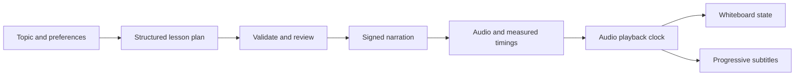

# Braynix · AI Interactive Whiteboard Tutor

Learn a topic through a short spoken lesson, synchronized diagrams, and follow-up questions. Braynix combines an interactive whiteboard with a separate streaming AI chat workspace.

Built by **Siva Sai** for the Braynix Studios technical assignment.

**[Live demo](https://ai-whiteboard-tutor-amber.vercel.app)** · **[Source code](https://github.com/sivasai1000/ai-whiteboard-tutor)** · **[Architecture](docs/architecture.md)**

## Try it

1. Open the live demo and choose **Whiteboard**.
2. Select **Play preview** to watch the bundled Moon-phases lesson without using AI credits.
3. To generate a lesson, enter a topic, choose a teaching level and reasoning effort, then select **Start learning**. Try “How does binary search work?” or “Why does the Moon change shape?”
4. Play, pause, seek, restart or change playback speed. Ask questions in the lesson's tutor panel.
5. Switch to **AI Chat** for a standalone conversation with streamed answers.

New lessons, narration and chat use the server's configured OpenAI account. The sample is a prewritten lesson with bundled AI narration, not a live generation. It runs approximately **1 minute 51 seconds at 1×**.

## Features

| Area | What is implemented |
| --- | --- |
| Lesson generation | Topic-first input, Beginner/Intermediate levels, six chapters and 18 teaching steps targeting about two minutes |
| Whiteboard | Arrays, flows, cycles, comparisons, bars, concept maps and equation steps, with curated animal/nature illustrations, labels, arrows and synchronized highlights |
| Moon visualization | A calculated Moon-phases scene with local Earth/Moon imagery, an orbital view and a corresponding view from Earth |
| Narration and captions | Generated voice, measured phrase timings and progressively revealed subtitle words |
| Playback | First-chapter playback while later narration prepares; play, pause/resume, seek, restart, speed control, zoom and fullscreen with an expanded-view fallback |
| Tutor follow-ups | Questions answered with the current lesson as context |
| AI Chat | Real SSE streaming, Markdown/code rendering, copy, stop, retry and regenerate |
| Personal library | Separate chat and lesson history, bookmarks and deletion confirmation; chat history is searchable |
| Responsive interface | Compact mobile composers, shared model/effort menus, mobile navigation and locally served official branding |

Both workspaces offer **Low, Medium and High** reasoning effort. Only the server-configured model is enabled. Other model entries open a contact dialog; they do not change the active model or start a provider request. Higher effort can increase latency and cost.

## Run locally

Use **Node.js 24.x** and npm. An OpenAI API account with credits and access to the configured models is needed for live AI features. The bundled preview works without a key.

```bash
git clone https://github.com/sivasai1000/ai-whiteboard-tutor.git
cd ai-whiteboard-tutor
npm ci
cp .env.example .env.local
```

Edit `.env.local` and set `OPENAI_API_KEY`. Keep the key on the server; do not put it in a `NEXT_PUBLIC_` variable or commit it to Git.

```bash
npm run dev
```

Open **http://127.0.0.1:3000**.

| Command | Purpose |
| --- | --- |
| `npm run dev` | Start the local development server |
| `npm run build` | Compile the production application |
| `npm start` | Serve the production build after building |

`GET /api/health` reports whether an API key is configured and which model IDs are selected. It does not validate credits, model access or provider connectivity.

## Technology

| Layer | Implementation |
| --- | --- |
| Application | Next.js 16 App Router, React 19, JavaScript |
| Interface | Tailwind CSS v4, shadcn/ui, AI Elements and Lucide icons |
| AI Chat streaming | Vercel AI SDK 7, `@ai-sdk/react`, `@ai-sdk/openai` and Streamdown |
| Lesson generation | OpenAI Responses API with structured output and Zod validation |
| Narration | OpenAI Realtime API over a server-side WebSocket |
| Drawing and playback | React-rendered SVG and an HTML audio element |
| Persistence | Browser IndexedDB through `idb` |
| Hosting | Vercel, with Node.js API routes |

Components use reusable Tailwind class strings in feature-level `style.js` files. `globals.css` holds Tailwind imports and shared theme tokens.

## How a lesson works



1. **Plan:** the model returns six chapters with three steps each, targeting 270–310 spoken words. Steps describe narration, diagram objects, labels and object states. The model returns data; React controls the drawing layout.
2. **Check:** the backend validates structure, node references, diagram capacity and narration length. A separate model call reviews factual and narration/diagram consistency. An invalid result gets one correction attempt with concrete feedback, followed by the same checks. A second failure returns an error instead of substituting the sample.
3. **Record:** approved narration is signed. The voice service verifies the signature, records each teaching phrase, checks transcript similarity and joins the clips into chapter audio. PCM sample counts provide measured phrase boundaries.
4. **Align:** one transcription request per new chapter obtains word timestamps, which are matched to the authored narration. If alignment fails, playback retains the recording and uses word timings marked as estimated.
5. **Play:** playback becomes available when the first chapter is ready. Two workers prepare the remaining AI narration in the background. The audio element's `currentTime` selects the drawing state and visible caption words. Captions build progressively: “The” → “The Moon” → “The Moon reflects”. Pause, seek, restart and speed changes all use this clock. Seeking to an unfinished chapter waits for that recording; the total duration remains approximate until every chapter is measured.
6. **Reuse and recover:** completed audio and timing metadata are cached in IndexedDB. Cached recordings are checked for readable media and valid phrase boundaries before reuse. An unreadable chapter is replaced individually; other recordings are retained. Audio-output failures offer a playback retry without requesting new narration.

Whiteboard changes follow measured phrase boundaries; captions follow word timestamps when available. Seeking rebuilds the board from lesson data, so jumping backward restores earlier labels and highlights. Timestamp estimates and the model review improve consistency but do not guarantee exact phonetic timing or factual correctness.

For the Moon scene, code calculates the orbit and illuminated shape from a shared phase value. Other topics use the seven general diagram layouts with a shared symbol vocabulary. Recognized subjects such as lions, lionesses, zebras, grass, the Sun and Earth use local illustrations; arbitrary generated images or code are not accepted. Concept and flow layouts arrange the objects visible at the current teaching step. See the [architecture walkthrough](docs/architecture.md) and [astronomy model, sources and asset credits](docs/astronomy.md).

## Project structure

```text
src/
  app/                         App Router pages, metadata and API handlers
    api/lessons/               Generate and review lesson data
    api/speech/                Generate signed narration and timing metadata
    api/chat/                  Answer a lesson follow-up
    api/conversations/         Stream standalone chat responses over SSE
    api/health/                Report configuration status
    ai/                        AI Chat workspace
    lesson/[id]/               Lesson playback workspace
    explore/                   Topic discovery
    history/                   Lesson history
    saved/                     Saved lessons
  components/
    ui/                        Reusable shadcn/AI Elements components
    layout/                    Sidebar, application shell and mobile navigation
    composer/                  Shared responsive composer styles
    shared/                    Shared loading, empty and error states
  features/
    welcome/                   Lesson input and sample preview
    lesson/                    Diagrams, subtitles, player and timeline
    tutor/                     Lesson follow-up chat
    library/                   Lesson state and library screens
    ai/                        Streaming chat, history and conversation state
    model-settings/            Shared model, effort and access controls
  server/                      Provider services, prompts, signing and quotas
  lib/                         Schemas, storage, diagram contracts and utilities
public/
  brand/                       Official Braynix brand mark
  sample/                      Versioned preview audio and timing metadata
  visuals/astronomy/           Local Earth and Moon imagery
scripts/                       Sample-audio maintainer utility
docs/                          Architecture and astronomy documentation
```

Pages compose features; hooks manage browser behavior; server services own provider calls. API routes validate requests and delegate to those services. The project uses JavaScript (`.js` and `.jsx`).

## Configuration

[`.env.example`](.env.example) is the configuration template. All variables below are server-only.

| Variable | Default / purpose |
| --- | --- |
| `OPENAI_API_KEY` | Required for live lessons, narration and chat |
| `OPENAI_TEXT_MODEL` | `gpt-6-luna`; lesson planning, review and chat |
| `OPENAI_SPEECH_MODEL` | `gpt-realtime-2.1-mini`; Realtime narration |
| `OPENAI_VOICE` | `marin` |
| `NARRATION_SIGNING_SECRET` | Optional separate signing secret; otherwise the API key is used |
| `APP_ORIGIN` | Optional canonical application origin |
| `DAILY_LESSON_LIMIT` | `20` lesson requests per daily limit window |
| `DAILY_SPEECH_LIMIT` | `180` narration requests per daily limit window |
| `DAILY_CHAT_LIMIT` | `120` requests shared by standalone chat and tutor follow-ups |
| `UPSTASH_REDIS_REST_URL` | Optional shared Redis limiter URL |
| `UPSTASH_REDIS_REST_TOKEN` | Optional shared Redis limiter credential |
| `TRUST_PROXY` | `false`; enable only behind a proxy that overwrites forwarded IP headers |

Model availability depends on the provider account. Use compatible models for structured output, reasoning settings and Realtime audio; changing an environment variable alone does not ensure API compatibility. No separate Vercel AI Gateway account is required.

## Storage and API usage

**The application stores personal history in the browser, with no account login or cloud database.**

| IndexedDB database | Contents and limits |
| --- | --- |
| `braynix-lessons` | Up to 30 lessons, bookmarks, tutor messages and cached audio |
| `braynix-conversations` | Up to 40 conversations with 80 messages each |

Data belongs to the current browser and origin. It does not sync across devices; clearing site data removes it. Lesson URLs reference local records and are not public sharing links. Compatible older libraries are migrated locally, and old sample assets are retained so saved lessons keep the correct narration.

For AI Chat, the server receives the latest 24 text messages within a 48,000-character context limit. User messages are limited to 4,000 characters. Replies are checkpointed during streaming; reloading restores saved text without automatically restarting a paid request. Text sent for generation goes to OpenAI even though the app's history is stored locally.

API usage is bounded in several ways:

- A lesson request allows at most two planning calls and two review calls. Provider authentication, quota, network and cancellation failures do not trigger that correction loop; SDK transport retries are disabled.
- New narration is generated once and cached. Word alignment adds one transcription request per new chapter. The bundled preview requires no provider calls to play.
- Requests have body limits, timeouts, origin checks and global/IP/session quotas. Narration must match its signed lesson text.
- AI Chat defaults to Low effort. Low/Medium/High completion budgets, including reasoning, are capped at 3,000/5,000/8,000 tokens.

Without Redis, limits and the short-lived server audio cache are **per process**. Restarts and multiple serverless instances reset or split them. Configure Redis for shared limits across instances. Request quotas are not a dollar spending cap; monitor provider usage and billing controls.

## Verify the application

```bash
npm run build
npm start
```

The repository has no automated test suite. After changing the application or deployment configuration, manually verify:

1. **Preview:** play the sample, pause/resume, seek forward/backward, restart, change speed and enter/exit fullscreen. Check drawings and progressive captions against the audio.
2. **Live lesson:** with a configured key, generate a fresh topic, play all chapters and ask a tutor follow-up. These requests use API credits.
3. **AI Chat:** send a message, observe streamed text, stop a response, retry/regenerate and ask a follow-up.
4. **Persistence:** save a lesson and a chat, reload, check their separate history/saved views and confirm deletion works.
5. **Responsive UI:** check a narrow mobile viewport and desktop, including navigation, composer height, model/effort menus and the contact dialog.

A successful build or sample playback does not verify live provider access. Repeat a real lesson and chat after changing credentials or model configuration.

## Deploy on Vercel

1. Import the repository into Vercel using the Next.js preset and Node.js 24.x.
2. Configure `OPENAI_API_KEY` and the chosen model/limiter variables in Vercel's server-side environment settings. Never upload `.env.local` to Git.
3. Use `npm run build` as the build command. Ensure the hosting plan supports the lesson route's 180-second maximum duration.
4. Publish the production deployment and make sure its access settings allow evaluators to open the demo.
5. Verify the real learner flow on the public URL, including narration and SSE chat.

This repository disables automatic Git deployments in [`vercel.json`](vercel.json). A Git push updates source code only. To link and publish manually after configuring the environment:

```bash
npx vercel link
npx vercel --prod
```

The narration route opens an **outbound** WebSocket to OpenAI and returns WAV audio through a normal HTTP response. The app requires server API routes and cannot be hosted as a static export.

## Current limitations

- Teaching is English-first. Structural checks and a separate model review reduce errors but cannot guarantee factual accuracy.
- Visuals use controlled 2D layouts, curated symbols and plain/Unicode equations. The Moon-phases scene is specialized; arbitrary illustrations, LaTeX and general 3D simulations are not implemented.
- The Moon scene is not to scale, omits eclipses/inclination/libration and uses a Northern Hemisphere viewing convention.
- First-time lessons wait for narration preparation. Failed chapters can be retried while completed recordings are reused.
- Word timestamps can be approximate. Legacy recordings and alignment failures use estimated timings; cached audio is not silently regenerated.
- Narration signatures expire after seven days. Cached audio remains playable; an uncached expired chapter requires a newly generated lesson.
- History stays on one browser. Standalone chat is text-only, without file uploads, web browsing or tool execution.

**Alignment maintenance:** [`src/server/word-alignment.js`](src/server/word-alignment.js) uses `whisper-1` for word timestamps. OpenAI documents its shutdown on **February 26, 2027** in the [timestamp guidance](https://developers.openai.com/api/docs/guides/speech-to-text#timestamps). Replace this isolated adapter with a verified timestamp provider before that date to keep audio-derived captions for new recordings. Bundled and cached timing metadata remains usable.

<details>
<summary><strong>Maintaining the bundled preview</strong></summary>

The current Moon preview contains six AAC clips, WAV fallbacks and JSON timing tables under `public/sample/moon-phases-v1/`. Older sample directories remain for compatibility with saved lessons. Do not delete them as unused assets or overwrite released narration with different content; use new scene IDs and a new version directory.

The maintainer utility is separate from runtime. Recording/conversion uses macOS tools. AI recording and alignment require `.env.local` and consume API credits:

```bash
# Record the current sample with the configured AI voice.
node --env-file=.env.local --conditions=react-server scripts/generate-sample-audio.mjs --ai

# Add word timings to existing recordings without changing their audio.
node --env-file=.env.local --conditions=react-server scripts/generate-sample-audio.mjs --align-only

# Record using the local macOS Samantha voice without provider calls.
node --conditions=react-server scripts/generate-sample-audio.mjs --local
```

Already aligned chapters are skipped by `--align-only`.

</details>

## Credits and submission

Made by **Siva Sai** · [sivasaimallipudi9h@gmail.com](mailto:sivasaimallipudi9h@gmail.com)

The official brand mark and favicons are copied unchanged from [Braynix Studios](https://braynix.in/) and served locally. Astronomy asset provenance and assumptions are documented in [astronomy.md](docs/astronomy.md). AI coding tools assisted development; OpenAI provides runtime lesson generation, voice and answers.

Assignment reference: [Braynix Studios AI Whiteboard Tutor](https://github.com/Braynix-Studios/ai-whiteboard-tutor-assignment). Submission requires the source repository and verified live demo links in the [submission form](https://docs.google.com/forms/d/e/1FAIpQLSdFJoTxMEuFZrCHTbEgv7bbg2uLf33SjP7n0w2qUONR4kMRcA/viewform).
