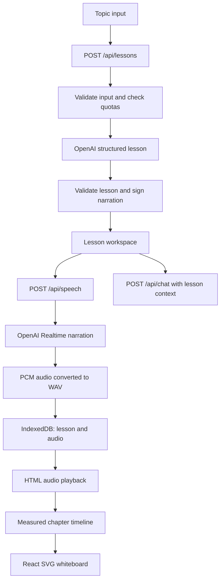

# Understanding Luma

## The five parts

1. **Next.js pages** choose the screen. They do not contain AI prompts or playback calculations.
2. **React feature components** display the welcome screen, whiteboard, controls, chat and library.
3. **The lesson provider** keeps the UI's lesson list synchronized with IndexedDB.
4. **Server services** validate inputs, call OpenAI and return safe structured data.
5. **The playback hook** connects measured audio time to the diagram renderer.

## Walk through a lesson

The learner types “How do fractions work?” in `TopicInput.jsx`. `WelcomeScreen.jsx` sends that topic and teaching level to `/api/lessons`. The route calls the shared request handler, which checks origin, payload size, schema, configuration and quotas.

`lesson-service.js` requests a lesson matching `generatedLessonSchema`. The provider must return narration and safe diagram primitives. For example, a fraction can be shown as a row of four rectangles with three highlighted. Shape coordinates and text are data; no model-generated code is executed.

The service checks diagram bounds and narration length, assigns IDs, and signs the narration. The browser saves the lesson, then opens `/lesson/[id]`.

`useLessonPlayer.js` checks for cached audio. Missing chapters are sent to `/api/speech`. The server verifies that the narration matches its signed token before requesting voice generation. It collects audio chunks, checks completion and transcript similarity, and returns a WAV. The browser reads the actual duration and caches the clip.

Once all clips are ready, the learner presses Play. One HTML audio element plays the chapters in sequence. `timeline.js` maps the overall playback time to a chapter and a local chapter fraction. `Whiteboard.jsx` renders elements whose `appearAt` has been reached. Seeking backward calculates this state again, so later elements disappear correctly.

## Why there is one clock

An independent animation timer would drift when the audio pauses, buffers or seeks. Instead, the current audio position drives the displayed time and diagram state. Playback speed changes do not need a separate timing correction because the browser's audio `currentTime` still reports the original media position.

Chapter durations initially use a narration estimate for loading UI. Playback uses measured audio durations. At an exact chapter boundary, the next chapter is selected; at the lesson's end, the final chapter remains visible.

## State and storage

- Component state holds input drafts and panel visibility.
- `LessonProvider` serializes bookmark and message changes to avoid overwriting simultaneous updates.
- IndexedDB stores structured lessons and audio Blobs. Audio is keyed by lesson and chapter IDs.
- Deleting a lesson removes its clips in the same transaction. Audio finishing after deletion is not saved as an orphan.
- Navigating away cancels generation/playback work and revokes temporary object URLs.

## Frontend and backend boundary

`src/server` modules import `server-only`. They own API keys, signatures and provider calls. Client code calls the three narrow API endpoints. Provider errors are translated into useful messages with request IDs; credentials and internal stack traces are not returned.

The server signs narration because a public unrestricted text-to-speech endpoint could spend credits on arbitrary text unrelated to a generated lesson. Signatures are not a substitute for quotas: anyone can still legitimately request a lesson, so rate and spending controls matter.

## Honest verification

Vitest checks the data and service rules. Playwright checks the user journey with a real browser and real bundled audio. Mocked AI responses exercise success/failure behavior without spending credits. A separate live smoke test must confirm the selected account's models, audio generation and follow-up answers before deployment is described as fully verified.

## Useful interview discussion points

- Why a deterministic board state makes seeking reliable.
- Why voice generation is separated from the lesson model.
- Why actual audio duration replaces estimated duration.
- Why React renders an allowlist of diagram primitives.
- Why data validation cannot guarantee teaching accuracy.
- The tradeoff between chapter-relative timing and word-level forced alignment.
- Why browser-local history is sufficient for this MVP, and what account sync would require.
- Why process-local rate limits are insufficient across multiple serverless instances.
