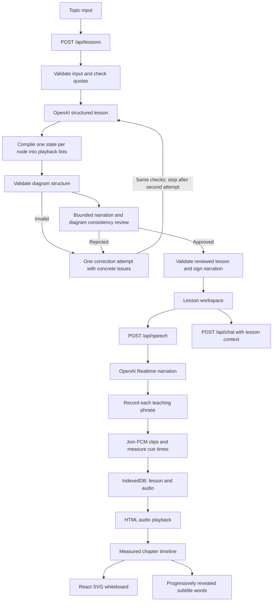

# Understanding Braynix

## The five parts

1. **Next.js pages** choose the screen. They do not contain AI prompts or playback calculations.
2. **React feature components** display the welcome screen, whiteboard, controls, chat and library.
3. **The lesson provider** keeps the UI's lesson list synchronized with IndexedDB.
4. **Server services** validate inputs, call OpenAI and return safe structured data.
5. **The playback hook** connects measured audio time to the diagram renderer.

## Walk through a lesson

The learner types “How do fractions work?” in `TopicInput.jsx`. The input shares compact composer styles with AI Chat. A model selector and settings button sit beside the send button; the settings menu contains effort and teaching level. Mobile inputs start at two lines, menus stay within the viewport, and empty screens omit suggestion rows. `WelcomeScreen.jsx` sends the topic, teaching level, configured model and selected effort to `/api/lessons`. The route calls the shared request handler, which checks origin, payload size, schema, configuration and quotas. The service rejects models other than the server's configured model before calling OpenAI; Low effort is the default.

`lesson-service.js` requests a plan matching `lessonPlanSchema`: six chapters with three steps each. The provider returns semantic diagrams and one `nodeStates` entry per visible object in each step. `lesson-plan.js` derives the visible/focus/dim arrays, validates that IDs exist and are unique, and checks the resulting `generatedLessonSchema`. This preserves the stored playback format while preventing contradictory visibility lists. For example, an algorithm uses ordered array nodes; each spoken comparison highlights a node and each elimination dims the discarded values. The seven general diagram layouts have deterministic coordinates, capacity limits, controlled colors and curated symbols. A specialized `moon-phases` layout uses a checked mathematical model, local imagery and an orbital view paired with the view from Earth. No model-generated code is executed.

The service checks narration length (230–340 words), unique node IDs, valid connectors, visible/focus/dim references, conflicting states and layout capacity, then calls `lesson-review.js`. That bounded review can correct narration when the diagram is already correct, or return concrete issues requiring diagram changes. The revised result must pass validation again before each chapter’s narration is signed. If either structure or review fails, one correction request includes the previous plan and issues; the corrected plan goes through all checks and an independent review again. A second failure stops. Provider authentication, quota, network errors and cancellation do not trigger this repair. A request uses at most two plans and two reviews within a 170-second deadline.

The reviewer uses the same low-cost model and no browsing; it reduces contradictions without guaranteeing factual truth. Broad educational prompts get a focused introduction; explicitly fictional stories are checked for narrative/diagram consistency. The browser saves a passing lesson, then opens `/lesson/[id]`. Failed generation preserves the user’s topic for a manual retry; it never silently substitutes the sample lesson.

`useLessonPlayer.js` coordinates two workers for AI narration. `audio-loader.js` reads cached audio, verifies that its Blob has a readable duration, and checks phrase continuity against the authored steps. Missing or unreadable chapters are sent to `/api/speech`; valid cached chapters are preserved. The server verifies that the narration matches its signed token before requesting voice generation. The supplied phrases must concatenate to the exact signed text. One Realtime session records those phrases sequentially. Each response is checked for completion and transcript similarity. Near-silent edges are trimmed, a short pause is inserted, and the clips are joined into a WAV with cue boundaries measured from PCM sample counts. The word-alignment adapter transcribes the joined recording once with word timestamps, validates them, and matches them to the original narration using an ordered token alignment constrained by phrase boundaries. It preserves authored wording. The browser checks phrase continuity and word bounds, reads the media duration and caches the recording with both timing levels. A timeout or poor alignment falls back to estimated word positions while retaining the generated voice; cancelled requests remain cancelled.

Once the first chapter is ready, the learner can press Play while the other recordings prepare. One HTML audio element plays the chapters in sequence. Seeking into a chapter that is still preparing preserves the requested position and waits; playback resumes there when its recording arrives. A failed chapter does not discard completed recordings or stop the other workers. Retry preserves the selected chapter and local position. Decoder errors bypass that chapter's cache; browser audio-output errors retry playback without buying another recording.

`timeline.js` maps the overall playback time to a chapter and its measured phrase cue. `resolveVisualStep` reconstructs visible, highlighted and dimmed nodes, applying updates through the active step. `VisualDiagram.jsx` renders that state with responsive positions from `visual-layout.js`. Concept and flow diagrams arrange only currently visible objects, while ordered arrays, comparisons and cycles retain stable positions. `visual-symbols.js` provides one vocabulary for generation, validation and `DiagramSymbol.jsx`; curated animals and natural objects use local SVG illustrations. Normalization runs before review so it checks the same subject the renderer displays. Seeking backward reconstructs earlier values and removes later changes, rather than attempting to reverse animation side effects.

`MoonPhaseScene.jsx` receives `cueProgress` from that same timeline. `resolveMoonPhase` rebuilds the starting value from earlier steps, then interpolates toward the current step's end value. Holding steps keep the phase fixed. `moonGeometry` and `moonLitPath` calculate both views from that single phase; seeking therefore cannot leave one view behind. `MOON_SCENE_CONTRACT` is shared by generation and accuracy review, and `checkMoonScene` rejects unknown objects, invalid phase ranges and backward/oversized transitions. See [astronomy.md](astronomy.md) for model limitations and source provenance.

## Why there is one clock

An independent animation timer would drift when the audio pauses, buffers or seeks. Instead, the current audio position drives the displayed time and diagram state. Playback speed changes do not need a separate timing correction because the browser's audio `currentTime` still reports the original media position.

Unfinished chapters initially use estimated durations, and the total is marked approximate. Each completed recording replaces its estimate while preserving the selected chapter and local playback time. Playback uses measured audio durations. At an exact chapter boundary, the next chapter is selected; at the lesson's end, the final chapter remains visible.

`LessonSubtitles.jsx` uses the same active phrase as the diagram, then reveals the cumulative prefix of words whose start times the audio has reached. It uses no animation timers and performs no text highlighting. A new phrase resets the prefix. The phrase is also measured invisibly, outside the accessibility tree, to keep the player from moving as visible text grows. Whiteboard updates remain tied to phrase boundaries. Older saved lessons still use their original `appearAt` percentages and `subtitles.js` estimates; their data is preserved without pretending that measured cues exist. Captions and the player are composed inside `Whiteboard.jsx`, so they remain together when `useLessonFullscreen.js` expands the mounted lesson. Native fullscreen is preferred; the fallback covers the browser viewport, keeps focus inside the lesson and restores focus when Escape is pressed.

Cached Moon previews from the previous release can be upgraded without replacing audio. `sampleWordTimingVersion` records a successful metadata fetch; `wordTimingVersion` records validated/fallback words in IndexedDB. A failed offline metadata request does not mark the sample upgrade complete, so a subsequent online visit can recover. Older cached AI audio uses estimates without an automatic paid backfill.

## State and storage

- Component state holds input drafts and panel visibility.
- `LessonProvider` serializes bookmark and message changes to avoid overwriting simultaneous updates.
- IndexedDB stores structured lessons, audio Blobs, measured durations and phrase cue tables. Audio is keyed by lesson and chapter IDs.
- Deleting a lesson removes its clips in the same transaction. Audio finishing after deletion is not saved as an orphan.
- Navigating away cancels generation/playback work and revokes temporary object URLs.

## Frontend and backend boundary

`src/server` modules import `server-only`. They own API keys, signatures and provider calls. Client code calls the three narrow API endpoints. Provider errors are translated into useful messages with request IDs; credentials and internal stack traces are not returned.

The server signs narration because a public unrestricted text-to-speech endpoint could spend credits on arbitrary text unrelated to a generated lesson. Signatures are not a substitute for quotas: anyone can still legitimately request a lesson, so rate and spending controls matter.

## Honest verification

Run `npm run build` to verify compilation, then follow the manual verification steps in the README. The bundled sample checks playback without API credits. Live lesson generation, narration and chat must be checked with a configured provider account before deployment is described as fully verified.

## Useful interview discussion points

- Why a deterministic board state makes seeking reliable.
- Why voice generation is separated from the lesson model.
- Why actual audio duration replaces estimated duration.
- Why React renders controlled semantic layouts instead of accepting model-generated coordinates or markup.
- Why data validation cannot guarantee teaching accuracy.
- Why the second consistency check adds cost and latency, and why it still cannot guarantee factual accuracy.
- The timing tradeoff: separately recorded phrases give stable board boundaries; one additional transcription call provides word starts for progressively revealed captions. Timestamp estimates and small unmatched spans are not phoneme-accurate guarantees. The provider adapter has a documented retirement deadline in the README.
- Why browser-local history is sufficient for this MVP, and what account sync would require.
- Why process-local rate limits are insufficient across multiple serverless instances.
